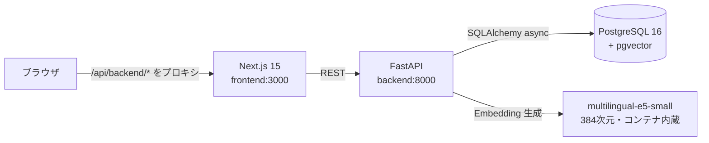

# TechInsight — AI搭載型ナレッジベース

技術記事1,000件を基盤とした、セマンティック検索対応のナレッジマネジメントシステムです。

  

## 機能

- **記事管理（CRUD）**: 一覧・詳細・投稿・編集・削除
- **3つの検索モード**
  - **キーワード検索**: pg_trgm による部分一致（日本語対応・入力中の自動絞り込み）
  - **セマンティック検索**: 多言語 Embedding モデルによる意味的類似検索（自然文クエリ対応）
  - **ハイブリッド検索**: 両者を RRF（Reciprocal Rank Fusion）で統合
- **カテゴリ絞り込み / ページネーション / 関連度スコア表示**

## アーキテクチャ



| レイヤ | 技術 |
|---|---|
| Frontend | Next.js 15 (App Router) / TypeScript / Tailwind CSS / TanStack Query |
| Backend | Python 3.12 / FastAPI / SQLAlchemy 2.0 (async) / Alembic |
| Database | PostgreSQL 16 + pgvector (HNSW) + pg_trgm |
| AI/ML | sentence-transformers `intfloat/multilingual-e5-small`（384次元・CPU推論） |
| Infra | Docker Compose（ワンコマンド起動） |

## クイックスタート

### 前提

- Docker / Docker Compose v2

### 起動

```bash
# 1. （任意）提供された articles.csv を配置
cp /path/to/articles.csv data/articles.csv

# 2. ワンコマンド起動（マイグレーション → データ投入 → Embedding 生成 → Web 起動）
docker compose up --build
```

初回は以下が自動実行されます:

1. PostgreSQL 起動（pgvector 拡張入りイメージ）
2. Alembic マイグレーション
3. `data/articles.csv` の取り込み（**無い場合はサンプル記事1,000件を自動生成**）
4. 全記事の Embedding をバッチ生成（CPU で数分程度）
5. API / フロントエンド起動

| URL | 内容 |
|---|---|
| http://localhost:3000 | Web アプリケーション |
| http://localhost:8000/docs | API ドキュメント（Swagger UI） |
| localhost:54320 | PostgreSQL（user/pass/db: `techinsight`） |

> 初回ビルドは Embedding モデルのダウンロードを含むため 5〜10 分程度かかります。
> 2回目以降の `docker compose up` はシード済みのためすぐに起動します。

### データを入れ直す場合

```bash
docker compose down -v        # DB ボリュームごと削除
docker compose up --build
```

## ディレクトリ構成

```
.
├── docker-compose.yml
├── data/                     # articles.csv の配置場所（ボリュームマウント）
├── docs/
│   ├── db-design.md          # DB設計書
│   ├── api-design.md         # API設計書
│   └── implementation-notes.md  # 実装の説明・工夫した点
├── backend/
│   ├── alembic/              # マイグレーション
│   ├── app/
│   │   ├── api/v1/           # ルーティング層（HTTP の入出力のみ）
│   │   ├── core/             # 設定
│   │   ├── db/               # セッション管理
│   │   ├── models/           # SQLAlchemy モデル
│   │   ├── repositories/     # DB アクセス層
│   │   ├── schemas/          # Pydantic スキーマ（入出力契約）
│   │   └── services/         # ビジネスロジック（検索・Embedding 連携）
│   ├── scripts/              # シード・CSV ローダー
│   └── tests/                # 単体テスト
└── frontend/
    └── src/
        ├── app/              # App Router
        ├── components/       # UI コンポーネント
        └── lib/              # API クライアント・型定義
```

## 開発

### バックエンド（ローカル）

```bash
cd backend
python -m venv .venv && source .venv/bin/activate
pip install -r requirements-dev.txt
docker compose up db -d                 # DB のみ起動
alembic upgrade head
uvicorn app.main:app --reload
```

### テスト / Lint

```bash
cd backend
pytest            # 単体テスト
ruff check .      # Lint

cd frontend
npm run typecheck # 型チェック
```

### フロントエンド（ローカル）

```bash
cd frontend
npm ci
npm run dev   # バックエンドは localhost:8000 で起動しておく
```

## ドキュメント

- [DB設計書](docs/db-design.md)
- [API設計書](docs/api-design.md)
- [実装の説明・工夫した点](docs/implementation-notes.md)
