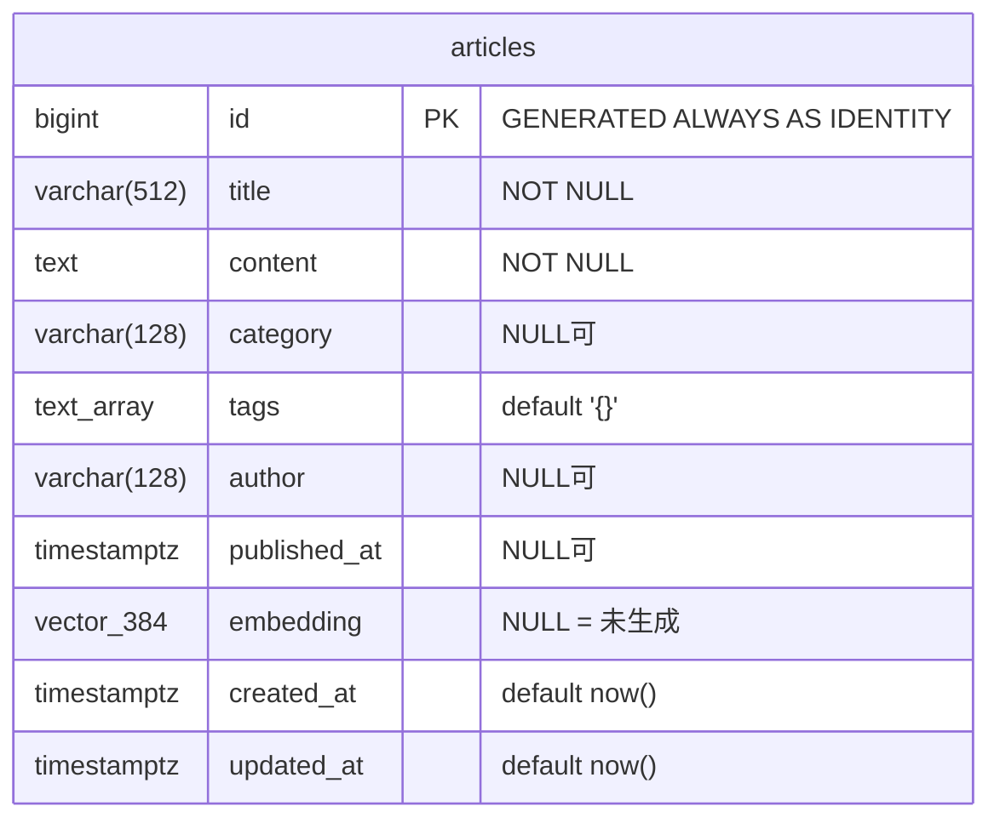

# 簡易DB設計書

## 1. 概要

- **DBMS**: PostgreSQL 16
- **拡張**: `pgvector`（ベクトル検索）, `pg_trgm`（日本語対応の部分一致検索）
- **マイグレーション**: Alembic（`docker compose up` 時に自動適用）
- **想定データ量**: 当面1万件規模 → 将来的な増加を見込んだインデックス設計

## 2. ER 図

現要件はエンティティが記事のみのため単一テーブル構成。将来的にユーザー管理やタグの正規化
（`tags` / `article_tags` の多対多）へ拡張する場合も、Alembic マイグレーションで段階的に移行できる。

## 3. カラム定義

| カラム | 型 | 制約 | 説明 |
|---|---|---|---|
| `id` | `BIGINT` | PK, IDENTITY | 連番。UUID ではなく BIGINT を採用（インデックス局所性・サイズ効率で有利） |
| `title` | `VARCHAR(512)` | NOT NULL | 記事タイトル |
| `content` | `TEXT` | NOT NULL | 記事本文 |
| `category` | `VARCHAR(128)` | NULL | カテゴリ（絞り込み用） |
| `tags` | `TEXT[]` | NOT NULL, default `{}` | タグ。現要件では配列+GINで十分と判断（正規化とのトレードオフは §5） |
| `author` | `VARCHAR(128)` | NULL | 著者名 |
| `published_at` | `TIMESTAMPTZ` | NULL | 公開日時（一覧のソートキー） |
| `embedding` | `VECTOR(384)` | NULL | セマンティック検索用ベクトル。`NULL` は未生成を表す |
| `created_at` | `TIMESTAMPTZ` | NOT NULL | レコード作成日時 |
| `updated_at` | `TIMESTAMPTZ` | NOT NULL | 更新日時（ORM の onupdate で自動更新） |

## 4. インデックス設計（1万件以上を想定）

| インデックス | 種別 | 対象 | 用途 |
|---|---|---|---|
| `ix_articles_embedding_hnsw` | HNSW (`vector_cosine_ops`) | `embedding` | セマンティック検索の近似最近傍探索 |
| `ix_articles_title_trgm` | GIN (`gin_trgm_ops`) | `title` | ILIKE 部分一致の高速化（日本語対応） |
| `ix_articles_content_trgm` | GIN (`gin_trgm_ops`) | `content` | 同上 |
| `ix_articles_published_at` | B-tree (`DESC NULLS LAST`) | `published_at` | 一覧の新着順ソート |
| `ix_articles_category` | B-tree | `category` | カテゴリ絞り込み |
| `ix_articles_tags` | GIN | `tags` | タグ検索（将来のタグ絞り込み用） |

### 設計判断

- **HNSW vs IVFFlat**: IVFFlat はデータ投入後のインデックス再構築（リスト数チューニング）が必要で、
  データが増えるたびに再調整が発生する。HNSW は逐次挿入に強く、件数増加時も再現率が安定するため、
  記事が継続的に追加されるナレッジベースの特性に合致する。メモリ使用量は増えるが1万〜10万件規模では問題にならない。
- **pg_trgm**: PostgreSQL 標準の全文検索（tsvector）は日本語の分かち書きに外部辞書（MeCab 等）が必要になる。
  trigram インデックスは言語非依存で ILIKE を高速化でき、運用部品を増やさない。
- **シーケンシャルID（BIGINT IDENTITY）**: UUIDv4 と比べ B-tree の挿入局所性が高く、インデックスサイズも半分以下。
  外部公開IDが必要になった場合は公開用カラムを追加する方針。

## 5. スケーラビリティと将来拡張

| 将来の課題 | 対応方針 |
|---|---|
| タグでの高度な集計・管理 | `tags`/`article_tags` テーブルへ正規化（マイグレーションで移行可能） |
| 10万件超での Embedding 生成負荷 | シードは既にバッチ処理。オンライン生成はジョブキュー（Celery / ARQ）へ切り出し、`embedding IS NULL` を未処理キューとして扱う設計が流用できる |
| 読み取り負荷の増大 | リードレプリカ + 接続プール（現状も pool_size/max_overflow 設定済み） |
| ベクトル検索のさらなる大規模化 | pgvector のまま HNSW パラメータ調整 → 限界が来たら専用ベクトルDBへ（リポジトリ層に検索が隔離されているため差し替え影響は限定的） |
